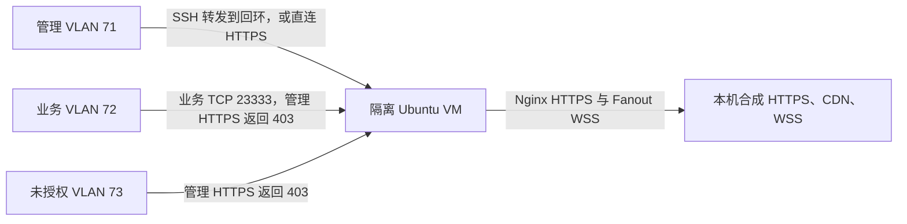

# Overseas Cache V2 隔离预生产验收

**PRODUCTION HOLD。** 本轮的管理、业务、证书和 WebSocket 流量仅来自临时隔离环境。现场 Renderer、管理网络和切换仍待现场验收。

## 版本

| 对象 | 值 |
|---|---|
| main | `8eaeb2aa8d8b6552fc5abe7aaf04581678814a88` |
| Tree | `23e87b4542caf050dfd2fe4dc64049485983bf89` |
| V1 基线 | `0e2bb77bdacc4e1f825858a0d59e2070828dd1b7` |
| PR #3 | MERGED，合并提交为上述 main |
| 原包版本 | 三个二进制均为 `8eaeb2aa8d8b` |
| amd64 SHA256 | `5be69c94b71eeb2936705edd551e5e252d0f41f71e287a458889aa7222d88945` |
| arm64 SHA256 | `3b68a357f4f2903a8575be2acd2f832497ae8dbb98642645c6f89ca2768be04c` |

精确 main CI 8/8 PASS，原包重用已验收的构建。三个隔离在线任务均校验 `SHA256SUMS`、本机架构的三个二进制和 `licenses/`。许可证包含 Go runtime、gorilla/websocket、x/net、x/text 及两份专利声明。既有小时级验收记录仍在 #5。 [main CI](https://github.com/yikkrrtykj/nginx-overseas-cache/actions/runs/46076576495) · [候选包](https://github.com/yikkrrtykj/nginx-overseas-cache/actions/runs/46076576495/artifacts/15236030131) · [#5](https://github.com/yikkrrtykj/nginx-overseas-cache/issues/5)

## 原候选包在线测试

Ubuntu 24.04 amd64、Ubuntu 26.04 amd64 和 Ubuntu 24.04 原生 arm64 由 GitHub 托管 VM 运行。实验拓扑由独立 VLAN 71、72、73 对应管理、业务、未授权来源，配合回环和只监听管理地址的临时 SSH。合成 HTTPS、CDN 和 WSS 上游绑定在本机地址，名称解析在启动安装前验证。 [测试运行及证据](https://github.com/yikkrrtykj/nginx-overseas-cache/actions/runs/46122017404)

| 场景 | 实测结论 |
|---|---|
| V1 实际安装、管理 ACL | 管理端登录成功，业务与未授权来源收到 403，业务端能取动态页面 |
| V2 兼容、默认管理入口 | 原密码记录与受保护配置逐字节保留，管理 CIDR 保留并加入回环。回环实际登录，远程直连无监听，管理 VLAN 实际 SSH 转发登录 |
| 显式 HTTPS 入口 | 实际绑定指定管理 IP，完整签发链与主机名校验通过。受信客户端登录，Cookie 含 Secure、HttpOnly、SameSite=Strict。业务与未授权来源 403 |
| 证书和文件权限 | 缺少 TLS 私钥或 Admin 无读权限时无 HTTPS 或明文端点。修复文件后实际登录和服务重启复验通过 |
| Chromium | 登录、配置保存、退出、合成网页识别及改密全部通过。改密前会话失效，改回原密码后实际登录 |
| 缓存及 WS | 缓存目录保留实际 V1 对象，V2 隔离缓存键的样本首次 MISS 后 HIT。动态两次请求各自回源。每个样本两客户端共用一个上游，校验 join / join_res 和五条有序二进制帧 |
| 配置 Helper 停止 | 请求返回服务不可用，受保护配置保持原内容。恢复后通过实际 API 应用并返回备份标识和脱敏状态 |
| Nginx 校验、一次 reload 失败 | 安装退出失败并恢复原配置、管理入口和数据平面 |
| Fanout、Admin 进程启动失败 | 两次独立注入，安装退出失败并恢复原服务及应用配置 |
| 安装暂存空间耗尽 | 64 KiB 隔离 tmpfs 产生实际 ENOSPC，安装在替换有效文件前中止，业务和管理仍可用 |
| V2 → V1 → V2 | 恢复 V1 原管理入口、ACL、密码、配置和已预热的缓存，验证 WebSocket。再次升级和重复安装通过 |
| 日志 | 最终证据扫描服务日志、Nginx 流量日志和实验日志。合成密码、配置 Token 和 WebSocket 探针 Token 均未出现 |

## 业务中断及恢复

| 环境 | 升级安装器耗时 | 升级 WS 恢复上界 | 回滚安装器耗时 | 回滚 WS 恢复上界 | HTTP 样本失败数 |
|---|---:|---:|---:|---:|---:|
| Ubuntu 24.04 amd64 | 0.659 s | 0.635 s | 1.210 s | 1.366 s | 0 / 43 |
| Ubuntu 26.04 amd64 | 1.187 s | 1.177 s | 2.765 s | 2.444 s | 0 / 54 |
| Ubuntu 24.04 arm64 | 0.984 s | 0.825 s | 1.732 s | 1.744 s | 0 / 48 |

WS 恢复上界取从中断前最后一次成功探针开始到故障后首次完成握手并收取正确首帧的时间。每次探针结束后间隔 180 ms。HTTP 记录为采样期间无失败。现场画面冻结、业务 SLA 及实际维护窗口须独立测量。

- [Ubuntu 24.04 amd64 拓扑、TLS、时间序列、日志与截图](https://github.com/yikkrrtykj/nginx-overseas-cache/actions/runs/46122017404/artifacts/15253919070)
- [Ubuntu 26.04 amd64 拓扑、TLS、时间序列、日志与截图](https://github.com/yikkrrtykj/nginx-overseas-cache/actions/runs/46122017404/artifacts/15254068664)
- [Ubuntu 24.04 原生 arm64 拓扑、TLS、时间序列、日志与截图](https://github.com/yikkrrtykj/nginx-overseas-cache/actions/runs/46122017404/artifacts/15253433645)

早期实验压缩包包含只在试验期间有效的合成值。已清理这些中间包，并用通过日志检查的本轮最终三份证据替换。 [清理执行记录](https://github.com/yikkrrtykj/nginx-overseas-cache/actions/runs/46122064684)

## 真实来宾机重启

- Ubuntu 24.04 官方镜像经正常重启后原密码、ACL 和业务可用。带有效待恢复标记的未提交配置在下一次启动时先被 Nginx 加载。前一版配置由显式调用 Helper 恢复。安装脚本在完成文件替换、systemd 重新读取前被 SIGKILL，真正重启后系统加载了未提交的 V2 服务定义。 [24.04 基线对照](https://github.com/yikkrrtykj/nginx-overseas-cache/actions/runs/46121718820/job/140907484224)
- Ubuntu 26.04 官方云镜像上，原包将 V2 可执行文件父目录隐式创建为 `0700`。服务用户无目录遍历权限，Admin 与 Fanout 启动失败，安装器恢复 V1。本问题出现在官方云镜像，在线托管 runner 上的同一候选包通过。 [26.04 基线对照](https://github.com/yikkrrtykj/nginx-overseas-cache/actions/runs/46121907356/job/140908045274)

## 独立修复回归

[Draft PR #8](https://github.com/yikkrrtykj/nginx-overseas-cache/pull/8) 的 HEAD 为 `63a39bfe5a920553633defc834f91af422f0d0dd`，Tree 为 `eaf78949174a37df34cce13d5e5f9bb497b5ab8c`。两个来宾机 job 先核对 Git HEAD，再构建待测包。安装器显式设置可执行路径权限，使用持久事务记录和快照，在 Nginx 启动前执行恢复。

| 来宾机回归 | Ubuntu 24.04 amd64 | Ubuntu 26.04 amd64 |
|---|---|---|
| 实际 V1 → 修复包 V2 | PASS | PASS |
| 正常系统重启，V1 密码、ACL、HTTP 数据平面 | PASS | PASS |
| 设定 HTTPS 管理入口后的系统重启，主机名及正负向访问 | PASS | PASS |
| 从持久化未提交配置恢复，在首个 Admin 请求前检查 Nginx 生效配置 | PASS | PASS |
| 安装程序返回 137 后系统重启，恢复 V1 服务、密码和生效配置 | PASS | PASS |

- [两台来宾机完整回归](https://github.com/yikkrrtykj/nginx-overseas-cache/actions/runs/46122474098) · [24.04 原始证据](https://github.com/yikkrrtykj/nginx-overseas-cache/actions/runs/46122474098/artifacts/15254183793) · [26.04 原始证据](https://github.com/yikkrrtykj/nginx-overseas-cache/actions/runs/46122474098/artifacts/15253863613)
- 同一 HEAD 的标准 V2 verification **8/8 PASS**，包括 Ubuntu 24.04 和 26.04 两个实际安装任务。 [CI 完整结果](https://github.com/yikkrrtykj/nginx-overseas-cache/actions/runs/46122474079)
- 原候选包和独立修复包均在 Ubuntu 24.04 原生 arm64 VM 通过在线全生命周期、管理、浏览器和失败回归。来宾机真实重启矩阵为 amd64。 [独立修复包的原生 arm64 证据](https://github.com/yikkrrtykj/nginx-overseas-cache/actions/runs/46123112839/artifacts/15255005696)

## 验收结论与现场手册

| 跟踪事项 | 当前状态 |
|---|---|
| #6 管理入口 | 原候选包 PARTIAL_PASS。Draft 修复包的两个来宾机重启回归通过。实际现场网段、管理入口及真实证书待验收。保持 OPEN |
| #7 升级与回滚 | 原候选包 FAIL。Draft 修复包通过已复现的重启阻断项对照回归。现场维护窗口及切换、回退仍待验收。保持 OPEN |
| #4 Renderer | 手册已准备。真实 Renderer 的自动重连和画面恢复待单独授权。Issue 为只读审阅 |
| #2 追踪 | OPEN |

人工检查顺序为核准发行对象和版本、复验候选包和 V1 快照、锁定管理入口及证书、测真实 Renderer，最后在批准窗口演练现场升级和回滚。失败触发条件包括管理失联、错误配置生效、旧代消息进入新连接、画面超批准阈值及回滚无法恢复。 [现场验收清单](PREPRODUCTION-SITE-CHECKLIST.md)

当前主分支没有应用 Draft 修复，建议 **HOLD**。本轮使用隔离环境，正式 Release 与生产操作继续保留至独立授权。
